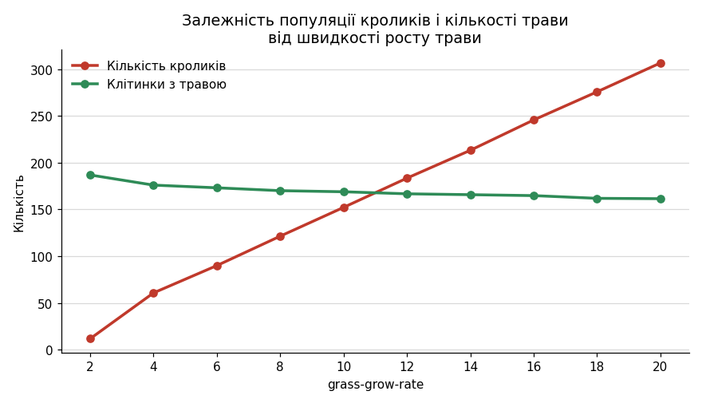
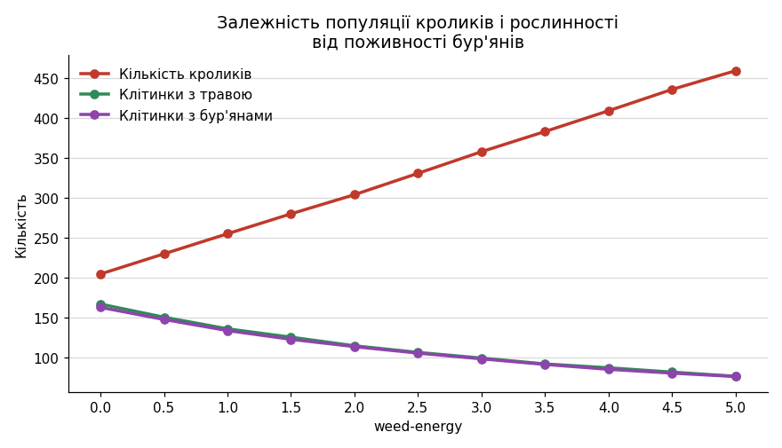
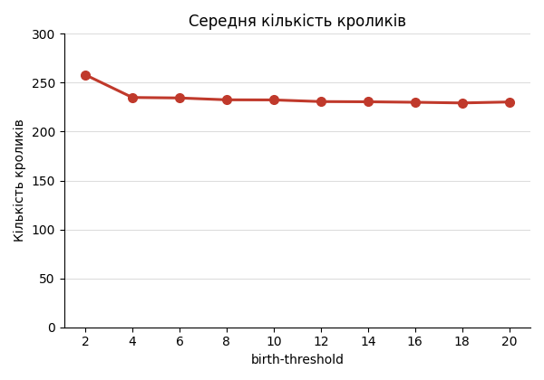
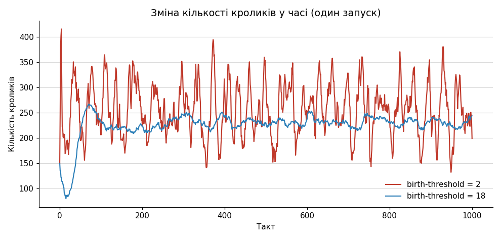

## Комп'ютерні системи імітаційного моделювання
## [Група], **[Прізвище Ім'я По батькові]**
### Лабораторна робота №1. Опис імітаційних моделей та проведення обчислювальних експериментів

 

### Варіант 6, модель у середовищі NetLogo:
[Rabbits Grass Weeds](http://www.netlogoweb.org/launch#http://www.netlogoweb.org/assets/modelslib/Sample%20Models/Biology/Rabbits%20Grass%20Weeds.nlogo)

 

### Вербальний опис моделі:
Модель описує просту екосистему "заячого лугу", яка складається з кроликів, трави та бур'янів. Кролики є агентами, які випадково переміщуються полем, а трава та бур'яни випадково виростають на порожніх ділянках поля. Коли кролик потрапляє на ділянку з травою або бур'янами, він їх з'їдає і отримує енергію. Якщо енергії достатньо, кролик розмножується, а якщо енергія закінчилася, кролик гине.

Поле складається з 41 × 41 = 1681 ділянки. Кожна ділянка може бути порожньою (чорною), з травою (зеленою) або з бур'янами (фіолетовою).

На кожному такті моделювання:
1. На кожній порожній ділянці з певною ймовірністю виростають бур'яни (weeds-grow-rate / 1000) і трава (grass-grow-rate / 1000).
2. Кожен кролик:
    - повертає на випадковий кут (rt random 50, lt random 50) і переміщується на одну ділянку вперед, витрачаючи на це 0,5 одиниці енергії;
    - якщо на ділянці є трава, з'їдає її та отримує grass-energy енергії;
    - якщо на ділянці є бур'яни, з'їдає їх та отримує weed-energy енергії;
    - якщо енергія більша за birth-threshold, ділить енергію навпіл і народжує одного нового кролика;
    - якщо енергія стала меншою за нуль, гине.
3. Симуляція зупиняється, якщо кроликів не залишилося.

Модель демонструє коливання чисельності, характерні для систем "хижак-жертва" (рівняння Лотки-Вольтерри): коли трави багато, кролики розмножуються, через це трави стає мало, частина кроликів гине, трава знову відростає, і цикл повторюється.

### Керуючі параметри:
- **number**: початкова кількість кроликів (від 0 до 500).
- **birth-threshold**: поріг енергії, після якого кролик розмножується (від 0 до 20).
- **grass-grow-rate**: швидкість росту трави, тобто ймовірність (у тисячних частках) появи трави на порожній ділянці за один такт (від 0 до 20).
- **grass-energy**: скільки енергії отримує кролик, з'їдаючи траву (від 0 до 10).
- **weeds-grow-rate**: швидкість росту бур'янів (від 0 до 20).
- **weed-energy**: скільки енергії отримує кролик, з'їдаючи бур'яни (від 0 до 10).

### Внутрішні параметри:
- **energy**: поточна енергія кролика. На початку задається випадково від 0 до 9.
- витрата енергії на один крок: 0,5 (константа в процедурі move).
- максимальний кут випадкового повороту: 50 градусів у кожен бік.
- колір ділянки (pcolor): визначає, що на ній росте (чорний: нічого, зелений: трава, фіолетовий: бур'яни).

### Показники роботи системи:
- кількість кроликів (монітор count rabbits та графік Populations);
- кількість трави на графіку Populations (count patches with [pcolor = green] / 4);
- кількість бур'янів на графіку Populations (count patches with [pcolor = violet] / 4).

### Примітки:
На графіку Populations кількість трави та бур'янів поділена на 4, щоб вона поміщалася в одному масштабі з кроликами. У таблицях експериментів нижче наведено реальну кількість ділянок, без ділення.

### Недоліки моделі:
- Кролики переміщуються зовсім випадково і не шукають їжу, навіть якщо трава знаходиться на сусідній ділянці.
- Розмноження відбувається без партнера, кролики не поділяються на самців та самок.
- Кролики не старіють і можуть жити необмежено довго, якщо їм вистачає їжі.
- Кролики завжди з'їдають бур'яни, навіть коли ті не дають енергії (weed-energy = 0). Тобто бур'яни не можуть бути шкідливими.
- У процедурі grow-grass-and-weeds спочатку перевіряється ріст бур'янів, а потім трави, причому трава може вирости на ділянці, де на цьому ж такті щойно з'явилися бур'яни, і замінити їх. Через це трава має невелику перевагу перед бур'янами.
- У моделі немає зміни пір року: трава та бур'яни ростуть з однаковою швидкістю весь час, хоча в природі влітку рослини ростуть швидко, а взимку майже не ростуть. Через це модель не показує, як популяція переживає зиму.

 

## Обчислювальні експерименти
Усі експерименти проводились за допомогою інструменту BehaviorSpace. Кожен запуск триває 1000 тактів, для кожного значення параметра виконано 5 запусків. Показники записувались на кожному такті, а для аналізу бралися середні значення за такти з 301 по 1000, щоб не враховувати початковий період, коли популяція ще не встановилася. Якщо кролики вимирали, середня кількість кроликів для такого запуску вважалася рівною нулю.

### 1. Вплив швидкості росту трави на чисельність кроликів
Досліджується залежність середньої кількості кроликів від швидкості росту трави (grass-grow-rate). Значення параметра змінюється від 2 до 20 з кроком 2. Додатково фіксується середня кількість ділянок з травою.

Інші керуючі параметри мають значення за замовчуванням:
- **number**: 150
- **birth-threshold**: 15
- **grass-energy**: 5
- **weeds-grow-rate**: 0
- **weed-energy**: 0

<table>
<thead>
<tr><th>Швидкість росту трави</th><th>Середня кількість кроликів</th><th>Середня кількість клітинок з травою</th></tr>
</thead>
<tbody>
<tr><td>2</td><td>11,7</td><td>187</td></tr>
<tr><td>4</td><td>60,7</td><td>176</td></tr>
<tr><td>6</td><td>90,0</td><td>173</td></tr>
<tr><td>8</td><td>121,4</td><td>170</td></tr>
<tr><td>10</td><td>152,2</td><td>169</td></tr>
<tr><td>12</td><td>183,5</td><td>167</td></tr>
<tr><td>14</td><td>213,2</td><td>166</td></tr>
<tr><td>16</td><td>245,7</td><td>165</td></tr>
<tr><td>18</td><td>275,8</td><td>162</td></tr>
<tr><td>20</td><td>306,6</td><td>162</td></tr>
</tbody>
</table>

Чим швидше росте трава, тим більше кроликів може прогодувати луг, і залежність майже лінійна: кожні 2 одиниці швидкості росту додають приблизно 30 кроликів. При швидкості 2 трави майже не вистачає, і кроликів залишається в середньому лише близько 12. Цікаво, що кількість трави на полі при цьому майже не змінюється: при швидкості від 4 до 20 вона тримається на рівні від 162 до 176 ділянок. Тобто вся "зайва" трава, яка виростає швидше, одразу з'їдається додатковими кроликами, а рівень трави визначається не швидкістю її росту, а тим, скільки трави потрібно кролику, щоб вижити. Це відповідає класичній моделі "хижак-жертва", де рівновага жертви залежить від параметрів хижака.

### 2. Вплив поживності бур'янів на чисельність кроликів і рослинність
Досліджується, як поживність бур'янів (weed-energy) впливає на кількість кроликів, трави та бур'янів, якщо бур'яни ростуть так само швидко, як трава. Значення параметра змінюється від 0 до 5 з кроком 0,5 (5 це поживність трави).

Інші керуючі параметри:
- **number**: 150
- **birth-threshold**: 15
- **grass-grow-rate**: 15
- **grass-energy**: 5
- **weeds-grow-rate**: 15 (так само, як трава)

<table>
<thead>
<tr><th>Поживність бур'янів</th><th>Середня кількість кроликів</th><th>Клітинок з травою</th><th>Клітинок з бур'янами</th></tr>
</thead>
<tbody>
<tr><td>0</td><td>204,5</td><td>167</td><td>163</td></tr>
<tr><td>0,5</td><td>229,8</td><td>150</td><td>148</td></tr>
<tr><td>1</td><td>254,9</td><td>136</td><td>134</td></tr>
<tr><td>1,5</td><td>279,9</td><td>125</td><td>123</td></tr>
<tr><td>2</td><td>303,9</td><td>115</td><td>114</td></tr>
<tr><td>2,5</td><td>330,6</td><td>106</td><td>106</td></tr>
<tr><td>3</td><td>357,7</td><td>99</td><td>98</td></tr>
<tr><td>3,5</td><td>382,9</td><td>92</td><td>91</td></tr>
<tr><td>4</td><td>408,9</td><td>87</td><td>85</td></tr>
<tr><td>4,5</td><td>435,7</td><td>82</td><td>80</td></tr>
<tr><td>5</td><td>459,0</td><td>77</td><td>76</td></tr>
</tbody>
</table>

Коли бур'яни не дають енергії (weed-energy = 0), кроликів у середньому 204, тобто менше, ніж без бур'янів взагалі (приблизно 230 при тих самих налаштуваннях, див. експеримент 3). Бур'яни займають порожні ділянки, на яких могла б вирости трава, і кролики витрачають на них час. З ростом поживності бур'янів кількість кроликів зростає лінійно і при weed-energy = 5 досягає 459, а кількість і трави, і бур'янів падає більш ніж удвічі, бо їх з'їдає більше кроликів. Трави та бур'янів на полі майже однаково, тобто кролики не віддають переваги жодній рослині. При weed-energy = 5 бур'яни фактично стають такою самою травою, і результат (459 кроликів) добре збігається з тим, що можна очікувати з експерименту 1 для швидкості росту трави 30.

### 3. Вплив порогу розмноження на чисельність і стабільність популяції
Досліджується, як поріг розмноження (birth-threshold) впливає на середню кількість кроликів та на те, наскільки сильно коливається популяція. Значення параметра змінюється від 2 до 20 з кроком 2.

Інші керуючі параметри мають значення за замовчуванням:
- **number**: 150
- **grass-grow-rate**: 15
- **grass-energy**: 5
- **weeds-grow-rate**: 0
- **weed-energy**: 0

<table>
<thead>
<tr><th>Поріг розмноження</th><th>Середня кількість кроликів</th></tr>
</thead>
<tbody>
<tr><td>2</td><td>258,1</td></tr>
<tr><td>4</td><td>234,9</td></tr>
<tr><td>6</td><td>234,4</td></tr>
<tr><td>8</td><td>232,5</td></tr>
<tr><td>10</td><td>232,4</td></tr>
<tr><td>12</td><td>230,7</td></tr>
<tr><td>14</td><td>230,5</td></tr>
<tr><td>16</td><td>230,0</td></tr>
<tr><td>18</td><td>229,3</td></tr>
<tr><td>20</td><td>230,3</td></tr>
</tbody>
</table>

Результат вийшов неочікуваним: середня кількість кроликів майже не залежить від порогу розмноження і при всіх значеннях від 4 до 20 тримається близько 230. Трохи більше кроликів (258) лише при порозі 2. А от характер зміни популяції в часі сильно різний. При низькому порозі кролики розмножуються майже одразу, як тільки трохи поїли, тому популяція різко зростає, з'їдає траву і так само різко падає. На графіку зміни у часі видно, що при порозі 2 кількість кроликів постійно стрибає від 150 до 400, а при порозі 18 після початкового падіння тримається майже рівно, близько 230. Отже, високий поріг розмноження робить екосистему стабільнішою, а низький призводить до різких коливань, хоча середня чисельність при цьому майже однакова.
